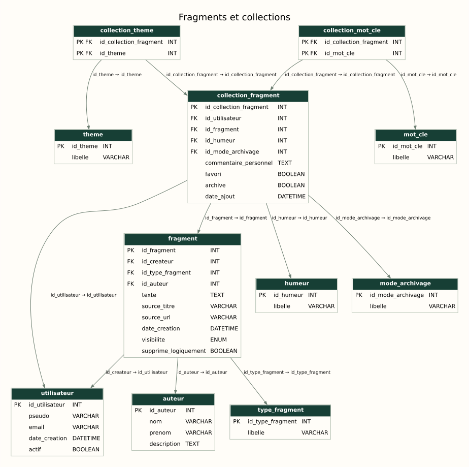

# Palimpseste — MariaDB database

A relational model for preserving, organising and resurfacing text fragments. Academic database project with **24 tables, 5 triggers and 12 stored procedures**.

[Français](README.md) · [Portfolio](https://portfolio.jobandjudith.com/en/) · [Separate Java application](https://github.com/erebethos/le-dernier-des-palimpsestes)

## Model and features

The original fragment and each user's collection entry are separate: multiple users can organise the same text without duplicating it.



[Groups and feedback](docs/schema-2.svg) · [Resurfacing, history and summaries](docs/schema-3.svg) · [Editable draw.io model](palimpseste_mpd.drawio)

Diagrams use table definitions and foreign keys from the SQL, grouped according to the three draw.io views. Arrows point from a foreign-key table to its referenced table; complete cardinalities are not shown.

Implemented features include referential integrity, unique and check constraints, collections and classification, individual/group feedback, interaction tracking, modification history, transactional procedures, cursor-based summaries and a prepared search query.

## Install and run

Use **MariaDB 10.11**, its `mariadb` client, and an account allowed to create the database, tables, triggers and procedures. MySQL compatibility is not claimed.

**The setup script drops and recreates the `palimpseste` database. Use a dedicated demo instance.**

```sh
git clone https://github.com/erebethos/palimpseste-bdd.git
cd palimpseste-bdd
mariadb --user=root --password --default-character-set=utf8mb4 < "Base de donnees.sql"
```

Adapt authentication to your installation. Unix socket authentication may require `sudo mariadb` instead of a password.

Before running test scenarios, open `mariadb --user=root --password palimpseste` and try:

```sql
CALL compter_fragments_conserves(1, @total);
SELECT @total AS saved_fragments;
-- Expected initial result: 2.
CALL rechercher_fragments_preparee('fragment');
```

## Explore the test scenarios

```sh
mariadb --user=root --password --default-character-set=utf8mb4 palimpseste < "Test Triggers et Procedures.sql"
```

The file contains **14 documented scenarios**, with queries showing the resulting changes. They are demonstrations to inspect, not an automated assertion suite. They modify data; recreate the database before repeating the same starting scenario.

| Action | Expected effect |
|---|---|
| Insert a fragment | `CREATION` movement |
| Add it to a collection | Resurfacing preference and `AJOUT_COLLECTION` movement |
| Edit through the procedure | Previous version recorded in history |
| Record feedback | Recipient becomes `REPONDU`; request status is updated |

For `bonus_tests_erreurs.sql`, execute the initial variable setup, then **one case at a time in the same session**. Five deliberately failing calls cover unauthorised editing, blank text and invalid visibility values. Their SQL errors are expected.

## Repository map

- `Base de donnees.sql`: complete schema, reference data and initial dataset.
- `Test Triggers et Procedures.sql`: nominal scenarios and observations.
- `bonus_tests_erreurs.sql`: expected procedure refusals.
- `palimpseste_mpd.drawio`: editable three-page physical model.
- `docs/schema-*.svg`: diagrams viewable without draw.io.
- `scripts/render_schema.py`: regenerate diagrams with Python 3 and Graphviz: `python3 scripts/render_schema.py`.

## Design and scope

A unique user/fragment pair prevents duplicate collection entries. A check constraint enforces exactly one target per feedback request: user or group. Both target foreign keys use `RESTRICT` on updates and deletes, retaining the referenced target and avoiding MariaDB’s incompatibility between this check and cascading/nullifying actions. Editing procedures validate the creator's ID; this is a domain rule, not an application authentication system.

There is no web interface or completed integration with the Java application. Further work includes automatic assertions, versioned migrations and application integration. Example emails use `example.com`.

Author: [François de Gennaro](https://portfolio.jobandjudith.com/en/).

[Compte rendu des vérifications / validation results](docs/validation.md).
